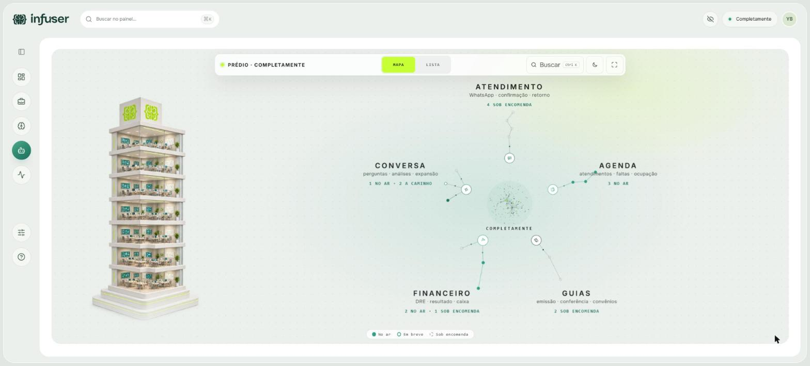
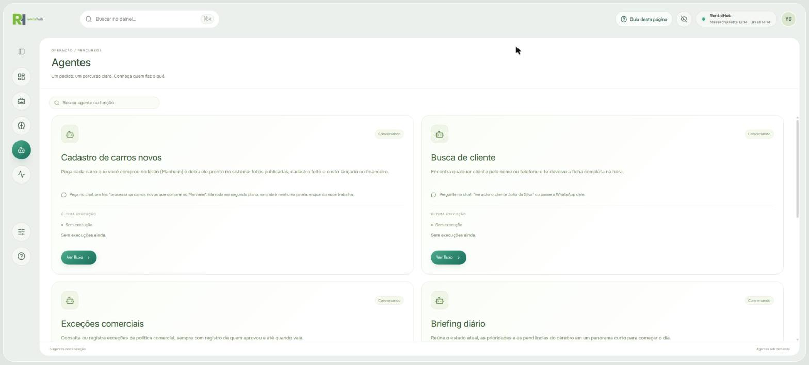
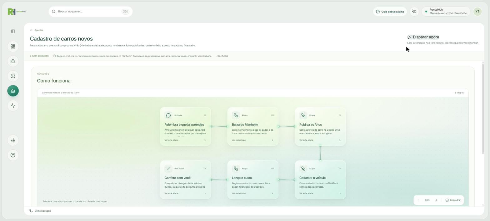
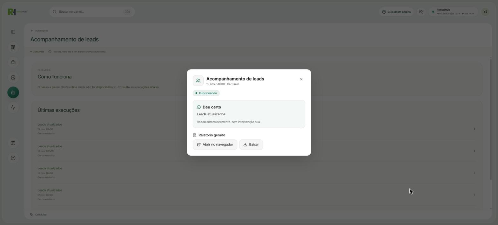

<picture>
  <source media="(prefers-color-scheme: dark)" srcset="assets/lockup-horizontal-onyx.svg">
  
</picture>

  

**Yan Galasso** · Founder @ Infuser 
AI for B2B operations · São Paulo, Brazil

 

 

## What Infuser does

We put AI inside the operations of B2B companies. We map how the work really runs, set up a second brain over the company's approved sources, and automate the processes that slow the team down.

I lead the technical side: the systems, the integrations and the agents.

 

## Catalyst Protocol

**Why it exists.** Automating a process nobody has mapped only makes its waste run faster. What people say they do and what they actually do can differ, and the gap is where the cost hides. So before we build anything, we look.

**What you get:** a map of how the process runs today, a proposed flow, a ranked list of opportunities and a plan to compare before and after.

 

## What we build

- **Ops panel + conversational second brain** over the company's approved sources
- **Process hub** where the team runs its routines, with owners, human decisions and a way out for exceptions
- **Integrations and agents** for ERPs, CRMs and systems without an API
- **Scheduled routines** that read, reconcile and post results where the team already looks

Client systems are private. What is public is the products we also sell at [useinfuser.com](https://useinfuser.com):

| Product | What it is |
|---|---|
| Kit Segundo Cérebro | Gives Claude Code memory across sessions |
| A Legião | 80 specialist agents for copy, traffic, sales and offers |
| Estúdio de CrIAção | 12 agents for video creation and editing |
| Kit de Skills | 10 skills that turn Claude Code into a team |
| JARVIS Kit | Apps and routines triggered by claps or voice |

 

## Panels

Screens from the Painel OS we run for clients. Client values and personal data are hidden. The files screen comes from our test environment.

 <b>Agents map.</b> Everything the company has, by area, marked as live, coming soon or on request.

 <b>Agents.</b> One card per job, asked for in the chat.

 <b>How one works.</b> Six steps from lookup to cost entry, and it stops to ask when a value looks off.

 <b>Every run reports back.</b> What happened, with the result one click away.

 <b>Files.</b> Originals organized by folder, always within reach.

 

## Stack

MCP (Model Context Protocol) · Tailscale · Backblaze B2

