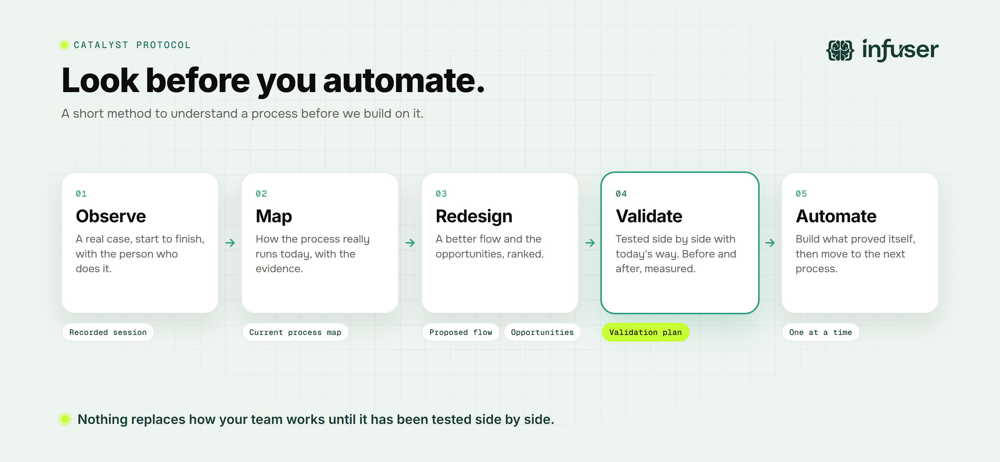
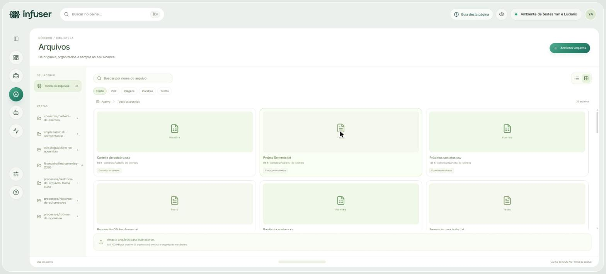

<picture>
  <source media="(prefers-color-scheme: dark)" srcset="assets/lockup-horizontal-onyx.svg">
  
</picture>

  

**Yan Galasso** · Founder @ Infuser 
I build AI systems that run inside B2B operations · São Paulo, Brazil

 

 

## What I do

Infuser puts AI to work inside B2B companies. I lead the technical side: I write the systems, the integrations and the agents, and I work with operations in Brazil and the US, in fields like law, healthcare, distribution and automotive.

Most of it is private because it runs on client data. The contribution graph on this profile is the public trace of that work. What I can show here is how we approach a process, how the systems are built, and the products we sell openly.

 

## Look before you automate

We call it the Catalyst Protocol. Automating a process nobody has mapped only makes its waste run faster, and what people say they do is often not what they do. So before we build anything, we watch a real case, start to finish, with the person who does it every day. What shows up on screen counts as measured. What is only said stays marked as an estimate.

The client ends up with a map of how the process runs today, a proposed flow, a ranked list of opportunities and a plan to compare before and after. Nothing replaces the current way of working until the new one has been tested side by side.

 

## How it is built

The core is a multi-tenant MCP server in Node.js and TypeScript, and client businesses run on it. The parts I care about most are not the framework:

- Each client is an isolated tenant, encrypted at rest, and access is granted by area, so HR does not see finance.
- Every tool call is audited, and documents are versioned with optimistic locking, so nothing gets silently overwritten.
- Where a system has no API, a scheduled browser worker operates it, and it stops to ask a person when a value looks off.
- Every run reports back what happened, with the result one click away.

On top of that sits an ops panel with a conversational second brain over the company's approved sources, and a work screen per routine with an owner, the human decisions and a way out for exceptions.

 

## Products

Client systems are private. What is public is what we also sell at [useinfuser.com](https://useinfuser.com), where prices and details live:

| Product | What it is |
|---|---|
| Kit Segundo Cérebro | Gives Claude Code memory across sessions |
| A Legião | 80 specialist agents for copy, traffic, sales and offers |
| Estúdio de CrIAção | 12 agents for video creation and editing |
| Kit de Skills | 10 skills that turn Claude Code into a team |
| JARVIS Kit | Apps and routines triggered by claps or voice |

There is also a free Central with 67 guides and packages, from the first prompt to the first agent running.

 

## Panels

Screens from the Painel OS, the panel our clients work in. The files screen comes from our test environment.

 <b>Agents map.</b> Everything the company has, by area, marked as live, coming soon or on request.

 <b>Files.</b> Originals organized by folder, always within reach.

<!-- DECISION (Yan): three more prints are hidden (agents, one agent flow, run result). They show a client name, a client location and third-party system names. Clause 8 of the Auto Select contract allows a public mention only after prior validation of the content by the client and without operational data. Restore them only after Hercilio approves the content. Files are in C:\tmp\readme-prints. -->
 

## Stack

MCP (Model Context Protocol) · Tailscale · Backblaze B2

If you run a B2B operation and want to see where AI fits, start at [useinfuser.com](https://useinfuser.com).

